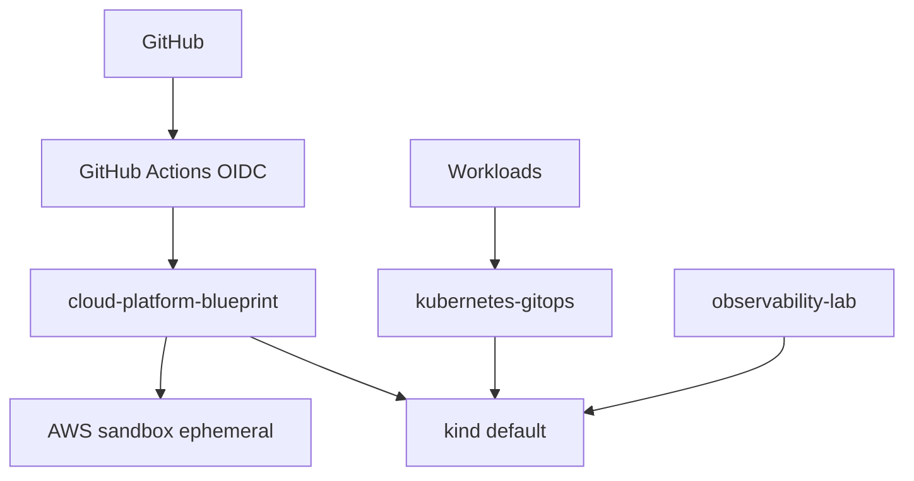

# Architecture

This portfolio is **one platform** with separately reviewable GitHub repositories. It is not sixteen disconnected cloud accounts.

## Runtime policy

| Target | When to use | Cost |
| --- | --- | --- |
| kind | Default. Daily development, CI-shaped demos, GitOps, SRE exercises | $0 |
| GitHub Pages / Actions / GHCR | Docs, CI, container registry | $0 public |
| AWS sandbox | Ephemeral Terratest / CDK / EKS demos | Apply, demo, destroy |
| Always-on EKS / RDS / NAT | Never | Avoid |

AWS is the interview cloud (Terraform + OIDC + optional CDK). kind is the cluster you actually run.

## System context

## Repository responsibilities

- **cloud-platform-blueprint** — cluster bootstrap (kind now, AWS later), Helm platform components, Terraform env roots.
- **terraform-modules** — versioned AWS modules; create/destroy is the integration test.
- **kubernetes-gitops** — desired state. CI builds images; GitOps PRs change tags. No `kubectl apply` in prod.
- **observability-lab** — Prometheus, Grafana, Loki, Tempo/OTel, RED and USE dashboards.
- **kubernetes-operations-toolkit** — failure modes, alerts, runbooks.
- **Askel** — job-search product at [getaskel.com](https://www.getaskel.com/). Kind GitOps workload: [efokou-labs/askel](https://github.com/efokou-labs/askel).
- **distributed-job-processor** — API, queue, workers, idempotency, DLQ.
- **agentic-ai-platform** — FastAPI agent service with eval gates and cost controls.
- **system-design-notes** / **awesome-sre** — MkDocs Material on GitHub Pages.
- **aws-cdk-examples** — pattern catalog with OIDC and teardown workflows.

## Promotion

1. PR: lint, tests, policy scan.
2. `main`: build immutable artifacts (GHCR), publish docs.
3. GitOps overlay `dev` may auto-update image tags.
4. `staging` / `prod`: protected environments and manual approval.

## Secrets

Never in Git. Local `.env` is gitignored. Cluster secrets use External Secrets / SOPS stubs. AWS uses Secrets Manager only after OIDC is wired.
